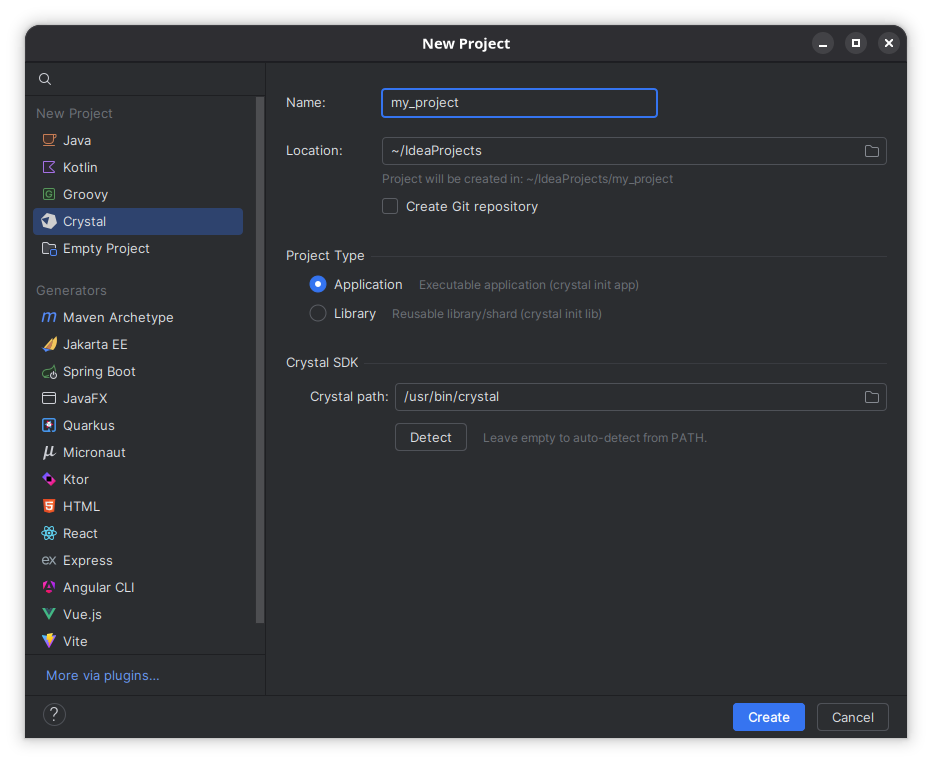
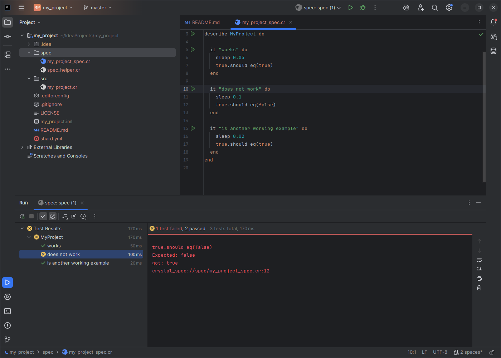
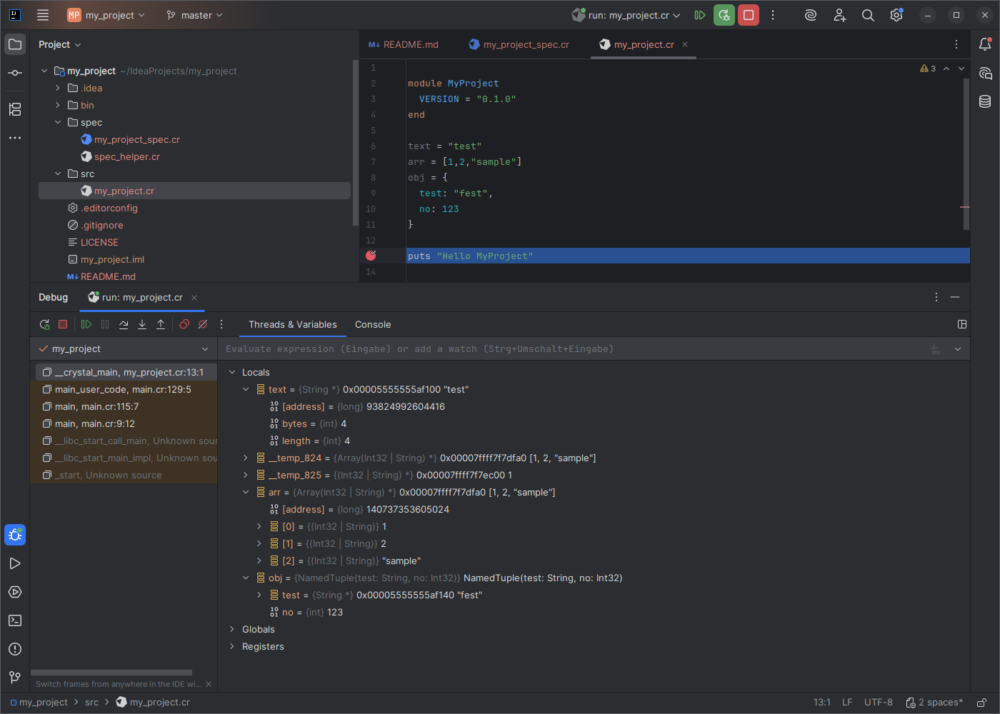

<p align="center">
  
</p>

# Crystal Language Plugin for JetBrains IDEs

[](https://plugins.jetbrains.com/plugin/32180-crystal-language)
[](https://plugins.jetbrains.com/docs/intellij/build-number-ranges.html)
[](https://crystal-lang.org)
[](LICENSE)

Crystal language support for IntelliJ IDEA, RubyMine, WebStorm, and other compatible JetBrains IDEs. The plugin provides editing, navigation, code intelligence, testing, and debugging through a native IntelliJ Platform integration without requiring a language server.

> [!WARNING]
> **Early Beta** — This plugin is under active development. Bugs and unsupported Crystal constructs are to be expected. Please [open an issue](https://github.com/magynhard/intellij-crystal/issues/new/choose) with a minimal example and the current and expected behavior.





## Highlights

### Editing

- Syntax and semantic highlighting for Crystal code, including macros, annotations, heredocs, regex, percent literals, and interpolation
- Normal Crystal highlighting and mapped syntax errors inside supported static module `macro finished` bodies
- Declaration-macro syntax with whitespace-sensitive type arguments, including pointer, proc, nilable, static-array, and metaclass suffix combinations
- Keyword block highlighting for structures such as `if`/`elsif`/`else`/`end`, methods, types, and exception handling
- Code folding, brace matching, line comments, automatic indentation, and automatic `end` insertion
- Formatting through Crystal's canonical `crystal tool format`
- 21 live templates for common Crystal constructs
- Dedicated color settings and TODO/FIXME indexing

### Code Intelligence

- Context-aware completion for local variables, parameters, methods, constants, types, namespaces, and `require` paths
- Receiver-aware DOT completion for literals, variables, method results, collections, constructors, and supported unions
- DOT completion retains unambiguous methods when a class reopening duplicates another method signature
- Multiline record fields and named arguments support keyword labels such as `macro : Bool` and `macro: false`
- Program-aware visibility based on one containing entry's transitive dependencies and the configured Crystal prelude; independent executables never share declarations merely because both load a helper
- Private type constants resolve across require-visible reopenings of their owning namespace; private file-level constants remain file-local
- Go to Definition, Go to Class, Go to Symbol, Find Usages, and Structure View
- Ctrl+B on receiver-less calls offers the overload chooser, including exact-owner reopenings when the file is opened without its containing program; local bindings retain precedence
- Statically written classes in supported module `macro finished` hooks expose typed accessors for completion, hover, source navigation, and chained member lookup; dynamic macro bodies remain opaque
- Typed `getter?` and `property?` accessors support member completion and hover, including keyword names such as `struct? : Bool`
- Ctrl+B / Ctrl+Click on type references inside those static macro bodies resolves their namespace- and require-visible definitions, including following definitions in the same file
- Guarded `responds_to?` member calls can navigate to known require-visible compatible declarations; hover distinguishes these candidates from exact dispatch
- Flow-aware member checks honor `case variable = expression` type branches and direct `is_a?` guards in later operands of pure `&&` chains
- Local names assigned in earlier logical operands resolve and navigate to their grouped assignment; hover shows the refined read-site type
- Instance-call return types retain fixed generic arguments through exact include and superclass edges, including `split(...).first?`
- Statically named `record` declarations resolve across required files in type annotations and references, with lexical namespaces, qualified paths, and record-constructor navigation
- Ctrl+B / Ctrl+Click navigation on individual FFI path segments in type annotations and expressions, such as `LibGMP::MPF` and `LibGMP::MpLimb.new!(num)`, with the standard target chooser for multiple matching declarations
- Namespace- and require-aware annotation navigation and documentation, with missing-annotation diagnostics
- Embedded language highlighting in heredocs and strings — `<<-SQL`, `<<-JAVASCRIPT`, `<<-CSS`, `<<-HTML`, `<<-JSON`, `<<-YAML`, `<<-CRYSTAL` and other language markers inject the target language's syntax highlighting when its plugin is installed; `# language=<id>` comments above heredocs, double-quoted strings, `%q`/`%Q` percent literals, and `:"symbol"` strings do the same (with optional `prefix=`/`suffix=`)
- Parameter Info for parenthesized calls, bare calls, DOT calls, constructors, and overloads
- Quick Documentation with rendered Crystal doc comments, Markdown, and navigable type links
- Hover information for variables, parameters, definitions, and inferred method return types
- Rename refactoring with compiler verification

### Inspections

- Direct `responds_to?` guards on locals and parameters prevent false missing-member warnings while preserving binding, branch, and reassignment boundaries
- Local-name diagnostics and Go to Declaration recognize condition assignments such as `if ucid = channel.receive`
- Missing-name diagnostics recognize require-visible FFI library namespaces in type annotations and library aliases in constructor receivers, including conditional aliases such as `LibGMP::MpLimb`
- Method-local `forall` type parameters are recognized in signatures and bodies, including dependent paths such as `T::MAX`, and support Go to Declaration; macro-generated type names such as `UInt{{n}}` do not produce false missing-name warnings in type annotations or expression arguments
- Argument count and argument type validation, including named arguments, defaults, overloads, splats, double splats, named-only parameters, and `lib fun` FFI calls
- Instance-variable type validation and unused-assignment detection
- Diagnostics for invalid empty collections, `lib fun` parameters without types, invalid single-quoted strings, colon spacing, and required parameters after optional ones
- Crystal-specific diagnostics for invalid dynamic `require` contexts and malformed multiline union types
- Shard dependency support — missing or outdated `shard.yml` dependencies are reported with a one-click `shards install` (balloon, editor banner, and in-file markers); installed shards stay indexed for completion and navigation without inspection noise
- Optional Ameba linting — enable under **Settings | Languages & Frameworks | Crystal | Ameba Linter**; diagnostics stream from the configured `ameba` binary (manual path, project `bin/ameba`, or `PATH`) with an explicit `ameba --fix` action, while overlapping built-ins step aside

The plugin's type inference supports many common literals, collections, variables, assignments, control-flow expressions, constructors, and call chains. Simple indexed writes retain their RHS value, including conditional and rescued paths. It is intended to provide useful editor feedback, not to replace the Crystal compiler's complete type system.

### Run, Test, and Debug

- Run configurations for `crystal run`, `crystal build`, and `crystal spec`
- Configurable compiler path, arguments, environment variables, and working directory
- Integrated spec runner with gutter actions, individual test execution, and a result tree
- Debugging through `lldb-dap`, including breakpoints, stepping, variable inspection, and bundled Crystal LLDB formatters
- Context actions for running Crystal files directly

### Embedded Crystal Templates

`.ecr` and `.html.ecr` files receive Crystal highlighting inside `<% %>` tags and HTML highlighting outside them. Completion, navigation, Parameter Info, documentation, hover information, Find Usages, and inspections are available inside injected Crystal code.

ECR code intelligence currently uses the configured Crystal prelude but does not infer a compiling project or shard entrypoint. Core types and literal methods are available, while project-specific declarations may not resolve inside a template yet.

### Project Setup

- New Project Wizard for Crystal applications and libraries
- Automatic Crystal compiler detection with a configurable project-level compiler path
- Crystal version and standard-library status in the project settings
- Targeted standard-library indexing, including the `crystal/` runtime support tree, with a manual re-index action

## Requirements

- **IntelliJ Platform 2026.2 or later**
- **Crystal 1.x** for project creation, formatting, compiler-assisted checks, running, testing, debugging, and standard-library code intelligence
- **LLDB DAP** (optional) for debugging

No separate Java installation is needed to use the plugin: use the JetBrains Runtime bundled with your IDE. To build or develop the plugin, install **JDK 25** as described under [Development](#development).

The plugin searches `PATH` and common installation locations for the Crystal compiler. You can configure a different executable under **Settings | Languages & Frameworks | Crystal**.

For debugging, `lldb-dap` must be available as that command or installed in one of the standard locations checked by the plugin. Native Windows support is experimental and less extensively tested than Linux and macOS support.

### Installing Dependencies

#### Linux — Arch / Manjaro / EndeavourOS / CachyOS

```bash
sudo pacman -S crystal shards lldb
```

The `lldb` package includes `lldb-dap`.

#### Linux — Debian / Ubuntu / Mint / Pop!_OS

Install Crystal with the official installation script:

```bash
curl -fsSL https://crystal-lang.org/install.sh | sudo bash
```

The default `lldb` package in Debian and Ubuntu repositories may be too old or may not include `lldb-dap`. For a current LLVM release, use the official LLVM apt script:

```bash
wget https://apt.llvm.org/llvm.sh
chmod +x llvm.sh
sudo ./llvm.sh 22
sudo apt install lldb-22
```

The package installs a versioned binary such as `/usr/bin/lldb-dap-22`. The plugin currently looks for `lldb-dap`, so make the binary available under that name:

```bash
sudo ln -s /usr/bin/lldb-dap-22 /usr/bin/lldb-dap
```

#### Linux — Fedora / RHEL / Rocky

```bash
sudo dnf install crystal lldb
```

#### Linux — openSUSE

```bash
sudo zypper install crystal lldb
```

#### macOS

Install Crystal and LLVM through Homebrew:

```bash
brew install crystal llvm
```

On Apple Silicon, Homebrew does not install LLVM into `/usr/local/bin`. Add its `bin` directory to `PATH`, or create a symlink so the plugin can find `lldb-dap`:

```bash
sudo ln -s "$(brew --prefix llvm)/bin/lldb-dap" /usr/local/bin/lldb-dap
```

The LLDB installation provided by Xcode Command Line Tools does not always include `lldb-dap`; Homebrew LLVM is the more reliable option.

#### Windows

Native Windows support is experimental and requires the MSVC toolchain.

1. Install [Microsoft Visual C++ Build Tools](https://aka.ms/vs/17/release/vs_BuildTools.exe) with either the **Desktop development with C++** workload or the MSVC v143 component and a current Windows SDK.
2. Download a current MSVC build from the [Crystal releases page](https://github.com/crystal-lang/crystal/releases/latest). The `*-msvc-unsupported.exe` installer adds Crystal to `PATH` automatically; the ZIP archive provides a portable alternative.
3. Install LLVM from the [LLVM releases page](https://github.com/llvm/llvm-project/releases/latest). Enable **Add LLVM to the system PATH for all users** during installation so `lldb-dap.exe` is discoverable.

For a MinGW-w64-based Crystal installation, see the [official Crystal Windows guide](https://crystal-lang.org/install/on_windows/).

#### Verifying the Installation

```bash
crystal --version
lldb-dap --help
```

Only the Crystal command is required when you do not need debugging. If Crystal is installed outside `PATH` and the known detection locations, select its executable under **Settings | Languages & Frameworks | Crystal**.

## Installation

1. Open **Settings | Plugins | Marketplace** in your IDE.
2. Search for **Crystal Language**.
3. Install the plugin and restart the IDE.
4. Open **Settings | Languages & Frameworks | Crystal** to verify the detected compiler and standard library.

Direct link: [Crystal Language on the JetBrains Marketplace](https://plugins.jetbrains.com/plugin/32180-crystal-language)

The plugin is incompatible with the older `net.kenro.ji.jin.intellij.crystal-2` plugin. Disable or remove that plugin before installing this one.

For code intelligence across a multi-file program, select its Crystal Run, Build,
or single-file Spec configuration in the IDE toolbar. Files loaded by that entry
share its declarations. Without a matching configuration, the plugin uses the
nearest ancestor library entry (for example, `benchmark.cr` for `benchmark/ips.cr`)
only when its requires actually load the file; otherwise it analyzes the file's
own dependencies. Selecting a configuration distinguishes executables that share
library files. Conditional requires are still collected statically, without
evaluating compiler flags or macro expansion.

## Known Limitations

- The plugin is an early beta; some Crystal syntax and IDE workflows remain unsupported or incomplete.
- Editor type inference is intentionally conservative and cannot reproduce every compile-time macro or type-system decision made by the Crystal compiler.
- ECR injections currently have prelude-based code intelligence without project- or shard-entrypoint context.
- Native Windows support is experimental.

Please report parser errors, false-positive inspections, missing completion, navigation problems, and uncomfortable workflows through the [issue templates](https://github.com/magynhard/intellij-crystal/issues/new/choose).

## Architecture

Code intelligence is implemented directly on the IntelliJ Platform and does not require an external LSP:

```text
Crystal.flex (JFlex)     -> Lexer and tokenization
Crystal.bnf (GrammarKit) -> Parser and PSI tree
Stub indexes             -> Project-wide declarations and navigation
PSI analysis             -> Completion, references, inspections, and type inference
```

External toolchain actions continue to use the canonical Crystal and LLVM tools: formatting delegates to `crystal tool format`, run and test configurations invoke `crystal`, and debugging uses `lldb-dap`.

## Development

The project uses Kotlin, Java, JFlex, GrammarKit, and the IntelliJ Platform SDK.

### Java Setup

Install **JDK 25 (LTS)**; [Eclipse Temurin 25](https://adoptium.net/temurin/releases/?version=25) is recommended. Use a full JDK, not a JRE: the build is configured with a Java 25 toolchain.

Set `JAVA_HOME` to the JDK installation directory and add its `bin` directory to `PATH`. If you build from a JetBrains IDE, select JDK 25 as the **Gradle JVM** under **Settings | Build, Execution, Deployment | Build Tools | Gradle**.

Verify the setup before building:

```bash
java -version
javac -version
```

Both commands should report version 25. Gradle can also provision the Java 25 build toolchain automatically through Foojay, but an installed JDK is still needed to start Gradle. Use the checked-in Gradle wrapper; no separate Gradle installation is required. On Windows, use `gradlew.bat` instead of `./gradlew`.

### Building

```bash
git clone https://github.com/magynhard/intellij-crystal.git
cd intellij-crystal
./gradlew build          # Compile and run all tests
./gradlew buildPlugin    # Build the installable plugin ZIP
./gradlew runIde         # Launch a development IDE
./gradlew generateLexer  # Regenerate the Crystal lexer
./gradlew generateParser # Regenerate the Crystal parser and PSI
```

Generated lexer, parser, and PSI sources are committed for reproducible builds.

The parser suite also checks your git-ignored `playground.cr`. If it is missing,
the test creates an empty file; existing contents are never overwritten. Tests
that specifically require POSIX executable permissions or a POSIX shell are
reported as skipped on Windows; platform-independent discovery and indexing
tests still run there.

On Windows, Java's argument-file handling can fail to load test classes when the
Gradle cache path contains non-ASCII characters. If test startup reports a missing
`com.intellij.util.lang.PathClassLoader`, use an ASCII-only `GRADLE_USER_HOME`
(for example, `C:\GradleCache`) before running the wrapper. A new cache location
downloads the build dependencies again.

## Contributing

Issues and pull requests are welcome. Please read [CONTRIBUTING.md](CONTRIBUTING.md) before opening an issue or starting a larger change.

- [Report a bug](https://github.com/magynhard/intellij-crystal/issues/new/choose)
- [Request a feature](https://github.com/magynhard/intellij-crystal/issues/new/choose)
- [Report a UX issue](https://github.com/magynhard/intellij-crystal/issues/new/choose)

## License

MIT — see [LICENSE](LICENSE).

This project includes [Crystal LLDB Formatters](https://github.com/crystal-lang/crystal/blob/master/etc/lldb/crystal_formatters.py), licensed under the Apache License 2.0.
